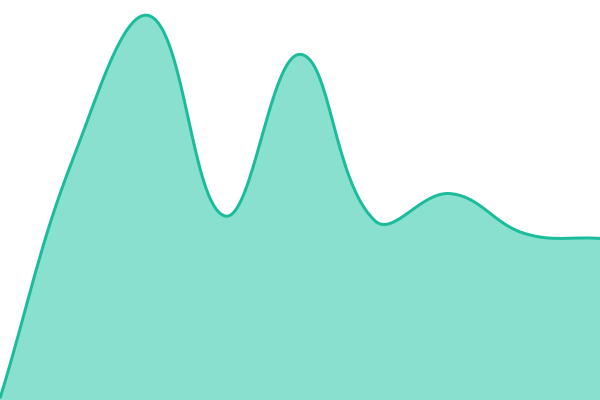

# [📈 En directe](https://latdg.github.io/estat): <!--live status--> **Tot funciona correctament**

This repository contains the open-source uptime monitor and status page for [latdg](https://latdg.github.io/estat), powered by [Upptime](https://github.com/upptime/upptime).

With [Upptime](https://upptime.js.org), you can get your own unlimited and free uptime monitor and status page, powered entirely by a GitHub repository. We use [Issues](https://github.com/latdg/estat/issues) as incident reports, [Actions](https://github.com/latdg/estat/actions) as uptime monitors, and [Pages](https://latdg.github.io/estat) for the status page.

## [📈 Live Status](https://demo.upptime.js.org): <!--live status--> **Tot funciona correctament**

<!--start: status pages-->
<!-- This summary is generated by Upptime (https://github.com/upptime/upptime) -->
<!-- Do not edit this manually, your changes will be overwritten -->
<!-- prettier-ignore -->
| URL | Status | History | Response Time | Uptime |
| --- | ------ | ------- | ------------- | ------ |
|  [Rellotge](https://latdg-rellotge.ignasicorney.workers.dev/) | Funciona | [rellotge.yml](https://github.com/latdg/estat/commits/HEAD/history/rellotge.yml) | 

 141ms
     
 | 

<a href="https://latdg.github.io/estat/history/rellotge">100.00%</a>
    

|  [Bot de transcripcions](https://latdg-transcripcions.ignasicorney.workers.dev/) | Funciona | [bot-de-transcripcions.yml](https://github.com/latdg/estat/commits/HEAD/history/bot-de-transcripcions.yml) | 

 156ms
     
 | 

<a href="https://latdg.github.io/estat/history/bot-de-transcripcions">100.00%</a>
    

|  [Difusió del canal](https://latdg-difusio.ignasicorney.workers.dev/) | Funciona | [difusio-del-canal.yml](https://github.com/latdg/estat/commits/HEAD/history/difusio-del-canal.yml) | 

 174ms
     
 | 

<a href="https://latdg.github.io/estat/history/difusio-del-canal">100.00%</a>
    

|  [Bot de resums](https://latdg-resums.ignasicorney.workers.dev/) | Funciona | [bot-de-resums.yml](https://github.com/latdg/estat/commits/HEAD/history/bot-de-resums.yml) | 

 146ms
     
 | 

<a href="https://latdg.github.io/estat/history/bot-de-resums">100.00%</a>
    

|  [Bot de plens](https://latdg-plens.ignasicorney.workers.dev/) | Funciona | [bot-de-plens.yml](https://github.com/latdg/estat/commits/HEAD/history/bot-de-plens.yml) | 

 146ms
     
 | 

<a href="https://latdg.github.io/estat/history/bot-de-plens">100.00%</a>
    

|  [Extractor d'àudio (mp3)](https://latdg-mp3.ignasicorney.workers.dev) | Funciona | [extractor-d-audio-mp3.yml](https://github.com/latdg/estat/commits/HEAD/history/extractor-d-audio-mp3.yml) | 

 136ms
     
 | 

<a href="https://latdg.github.io/estat/history/extractor-d-audio-mp3">100.00%</a>
    

<!--end: status pages-->

[**Visit our status website →**](https://latdg.github.io/estat)

## 📄 License

- Powered by: [Upptime](https://github.com/upptime/upptime)
- Code: [MIT](./LICENSE) © [Anand Chowdhary](https://anandchowdhary.com)
- Data in the `./history` directory: [Open Database License](https://opendatacommons.org/licenses/odbl/1-0/)
